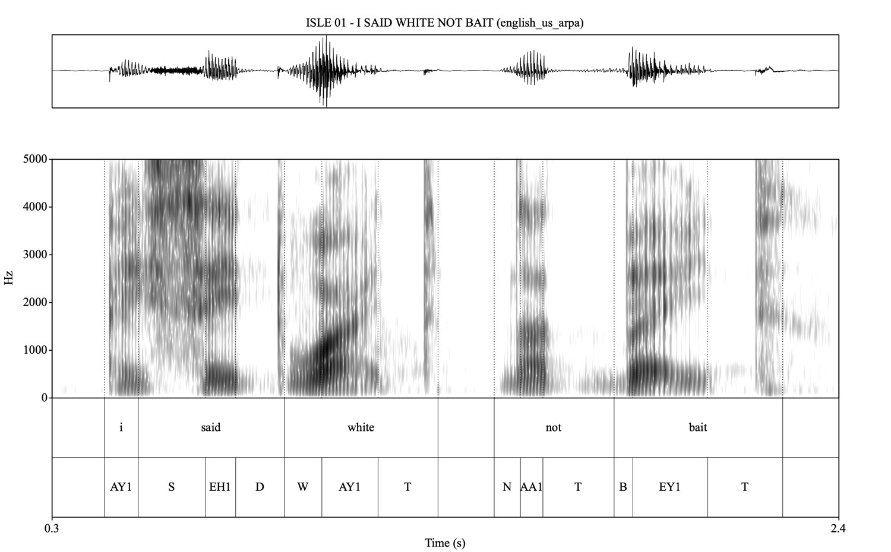

# Assignment 2a: Forced alignment with the Montreal Forced Aligner

The six provided recordings are aligned at word and phone level with MFA 3.4.4. There are six runs: two pretrained acoustic models, boundary fine-tuning, a model adapted to this data, a model trained from scratch, and the main model with reduced pronunciations. Missing words get pronunciations from a G2P model trained here, and the runs are scored against hand-corrected boundaries.

Everything, from the raw `data/` folders to the TextGrids, tables and Praat figures, is done by one script: `run_pipeline.sh`.

**Report:** part A of [`Report/Report.pdf`](../Report/Report.pdf) at the repository root (source: `Report/Report_2a.md`)

## Results at a glance

| Run | Acoustic model | Word boundaries within 20 ms of the main run | Word / phone boundaries within 20 ms of hand labels (3 ISLE files) |
|---|---|---|---|
| `arpa` (main) | `english_us_arpa` (pretrained) | – | 66.7 % / 77.3 % |
| `arpa_finetune` | same + `--fine_tune` | 100 % | 66.7 % / 77.3 % |
| `arpa_adapted` | `english_us_arpa` adapted to these files | 100 % | 66.7 % / 77.3 % |
| `arpa_reduced` | main + pronunciations without /t/ after /n/ | 100 % | 66.7 % / 77.3 % |
| `mfa_ipa` | `english_mfa` (pretrained, IPA) | 94.1 % | 52.4 % / – |
| `scratch` | trained on these 6 files only (97 s) | 5.0 % | 0 % / 0 % |

Own G2P model (`models/own_g2p_arpa.zip`, trained on the full `english_us_arpa` lexicon). Its accuracy was measured on a second copy trained without 2,000 random words: 7.9 % phone error and 30.1 % word error on those words (`results/g2p_eval.md`).



## 1. Install

MFA is installed from conda-forge. On macOS:

```bash
brew install micromamba
micromamba create -n mfa -c conda-forge montreal-forced-aligner=3.4.4 python=3.11 pandas tabulate
brew install --cask praat           # only needed for the Praat figures
```

On Linux, use `conda` or `mamba` with the same package list, and install Praat from praat.org. `run_pipeline.sh` finds Praat on the PATH or in `/Applications/Praat.app`; otherwise set `PRAAT=/path/to/praat` (without it the Praat figures are skipped).

Check the install with `micromamba run -n mfa mfa version` (it should print 3.4.x).

## 2. Run everything

```bash
cp -r <provided assignment folder>/wav data/wav     # the audio is not in the repository (licensed corpus data)
MFA="micromamba run -n mfa" bash run_pipeline.sh
```

If the env is already activated, `bash run_pipeline.sh` is enough. The run takes about 8 minutes on an Apple M4, most of it training the scratch model.

## 3. What each step does (and the equivalent single commands)

**Step 1: download the pretrained models**

```bash
mfa model download acoustic english_us_arpa     # + dictionary english_us_arpa, g2p english_us_arpa
mfa model download acoustic english_mfa         # + dictionary english_us_mfa,  g2p english_us_mfa
```

**Step 2: prepare the data** (`scripts/prepare_corpus.py`)

* The three `F2BJRLP*.wav` files are NIST SPHERE files with a `.wav` name. They are rewritten as standard WAV files.
* Transcripts are joined onto one line, and the split numbers and spelled acronyms are fixed.
* The result is MFA's corpus layout:

```
corpus/
├── f2b/            F2BJRLP1.wav  F2BJRLP1.lab  ...
└── isle_sess0131/  ISLE_SESS0131_BLOCKD02_01_sprt1.wav  ...lab  ...
```

**Step 3: build the dictionary** (`mfa g2p` + `scripts/build_dictionaries.py`)

```bash
# own G2P model, trained on the english_us_arpa lexicon (~55 min; models/own_g2p_arpa.zip is included, so this can be skipped)
mfa train_g2p ~/Documents/MFA/pretrained_models/dictionary/english_us_arpa.dict models/own_g2p_arpa.zip
# pronunciations for the corpus words missing from the lexicon
mfa g2p corpus models/own_g2p_arpa.zip dictionaries/oov_arpa_g2p.dict --dictionary_path english_us_arpa --num_pronunciations 1
# corpus words from the lexicon + those G2P words -> one small custom dictionary
# (MFA keeps its models in $MFA_ROOT_DIR, by default ~/Documents/MFA)
python scripts/build_dictionaries.py ~/Documents/MFA/pretrained_models/dictionary/english_us_arpa.dict \
       dictionaries/oov_arpa_g2p.dict dictionaries/custom_arpa.dict
```

**Step 4: align**

```bash
mfa align corpus dictionaries/custom_arpa.dict english_us_arpa outputs/arpa
mfa align corpus dictionaries/custom_arpa.dict english_us_arpa outputs/arpa_finetune --fine_tune
mfa adapt corpus dictionaries/custom_arpa.dict english_us_arpa models/english_us_arpa_adapted.zip
mfa align corpus dictionaries/custom_arpa.dict models/english_us_arpa_adapted.zip outputs/arpa_adapted
mfa align corpus dictionaries/custom_mfa.dict  english_mfa outputs/mfa_ipa
mfa train corpus dictionaries/custom_arpa.dict models/scratch_arpa.zip --output_directory outputs/scratch
mfa align corpus dictionaries/custom_arpa.dict models/scratch_arpa.zip outputs/scratch_widebeam --config_path config/widebeam.yaml
# reduced pronunciations (no /t/ after /n/): can the aligner skip an unreleased /t/?
python scripts/add_reduced_variants.py dictionaries/custom_arpa.dict dictionaries/custom_arpa_reduced.dict
mfa align corpus dictionaries/custom_arpa_reduced.dict english_us_arpa outputs/arpa_reduced
```

**Step 5: analyze** (`scripts/analyze.py`)

Writes summary tables, boundary agreement between runs and duration flags. Then:

```bash
python scripts/compare_reduced.py        # which pronunciation the aligner chose -> results/reduced_variants.md
python scripts/evaluate_manual.py        # every run vs the hand labels in manual_labels/ -> results/manual_accuracy.md
```

**G2P evaluation** (optional, ~1 h): train a second G2P model with the 2,000 words in `results/g2p_heldout_words.txt` removed from the lexicon, predict those words, and score them:

```bash
LEX=~/Documents/MFA/pretrained_models/dictionary/english_us_arpa.dict                 # downloaded in step 1
grep -v -w -F -f results/g2p_heldout_words.txt $LEX > train.dict                    # lexicon minus held-out words
mfa train_g2p train.dict g2p_heldout.zip
mfa g2p results/g2p_heldout_words.txt g2p_heldout.zip heldout_pred.dict --num_pronunciations 1
python scripts/evaluate_g2p.py $LEX heldout_pred.dict                  # -> results/g2p_eval.md (our predictions: results/g2p_heldout_predictions.dict)
```

**Step 6: Praat** (`scripts/draw_alignment.praat`, `scripts/vowel_formants.praat`)

Draws the two waveform + spectrogram + TextGrid figures of the report, and measures F1/F2 of the ISLE vowels. Any other region: open it in Praat (below).

To look at any result interactively: open Praat, *Open → Read from file* both the `.wav` (from `corpus/`) and the `.TextGrid` (from `outputs/<run>/`), select both and click *View & Edit*.

## Folder layout

| Path | Contents |
|---|---|
| `data/` | the provided `transcripts/`; put the provided `wav/` folder here too (the audio is licensed corpus data, BU Radio News / ISLE, so it is not in the repository) |
| `corpus/` | prepared MFA corpus (made by step 2) |
| `dictionaries/` | `custom_arpa.dict` / `custom_mfa.dict` (corpus dictionaries), `custom_arpa_reduced.dict` (+ variants without /t/ after /n/), `oov_arpa_g2p.dict` (own G2P for missing words), `oov_arpa_pretrained_g2p.dict` / `oov_mfa_g2p.dict` (MFA's G2P, for comparison) |
| `config/` | `widebeam.yaml`: the wider beam for the scratch model |
| `outputs/<run>/` | **TextGrids** (words + phones tiers) and MFA's `alignment_analysis.csv` for the 6 runs + `scratch_widebeam` |
| `manual_labels/` | hand-corrected TextGrids of the 3 ISLE files (reference for `evaluate_manual.py`); they started from the main run's TextGrids, `outputs/arpa/isle_sess0131/` |
| `models/` | `own_g2p_arpa.zip` (our G2P model), `scratch_arpa.zip` (trained from scratch). The adapted model (92 MB) is not in git; `run_pipeline.sh` rebuilds it in about 30 s |
| `results/` | `summary`, `agreement_vs_arpa`, `flags_arpa` (.md/.csv), `manual_accuracy` (vs hand labels), `reduced_variants`, `g2p_eval` + `g2p_heldout_words.txt` + `g2p_heldout_predictions.dict`, `isle_vowel_formants.tsv`, `all_intervals.csv` (every interval of every run, input of the analysis) |
| `figures/` | the two Praat views used in the report: ISLE 01 and "judicial appointments" (F2BJRLP2) |
| `scripts/` | the Python and Praat scripts |
| `Report/` | the report source (.md); the PDF is part A of `../Report/Report.pdf` |

## Notes

* The `meta.json` inside `models/own_g2p_arpa.zip` shows MFA's own validation score of 100 % error. That internal check is wrong in MFA 3.4.4: the held-out predictions, `results/g2p_heldout_predictions.dict`, score 7.9 % phone error against the lexicon.
* The scratch-trained model is not deterministic: with only 97 s of training audio, different runs give different alignments, and a run can fail to align a file (the run included here could not align ISLE 01, so `outputs/scratch/` has no TextGrid for it and no `alignment_analysis.csv`; another run may align it). Its numbers describe this one run.
* The pretrained runs are almost deterministic: re-running moves a few boundaries by one 10 ms frame. Over full re-runs the main run scored 61.9–66.7 % (words) and 75.0–77.3 % (phones) within 20 ms of the hand labels, mean phone error 10.8–11.7 ms; with 21 word boundaries, one boundary is 4.8 points. None of the conclusions change.
* The first run downloads about 300 MB of MFA models (needs internet) into `~/Documents/MFA` (or `$MFA_ROOT_DIR`), so it takes longer than the ~8 min of later runs.
* No reference boundaries came with the data, so the 3 ISLE files were hand-corrected (`manual_labels/`, starting from the main run's TextGrids) and every run is scored against them (report section 5). The other checks compare runs with each other, use MFA's own scores and duration flags, and inspect spectrograms.
* `run_pipeline.sh` starts by deleting `corpus/` and `outputs/` and rebuilds them; copy `outputs/` first if you want to compare with the committed TextGrids (the scratch model will differ).
