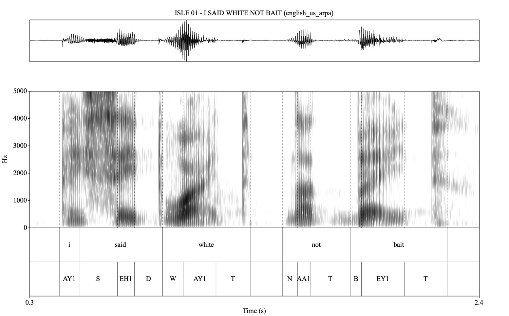
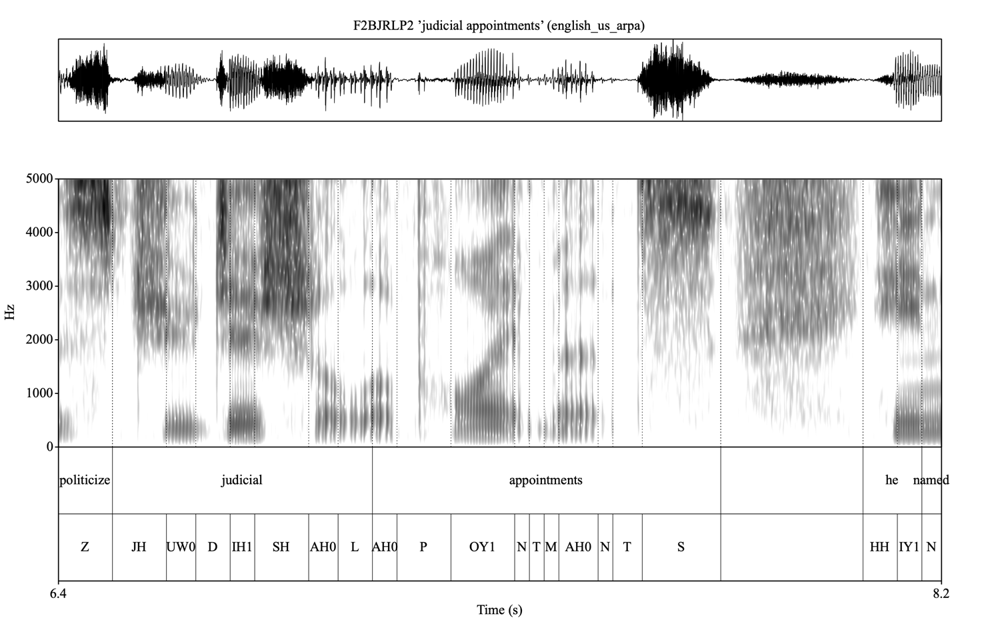

**Repository:** <https://github.com/sudarshan032/ltrc-assignment2-alignment-emotion> (folder `2a_forced_alignment/`: scripts, install and run instructions, all TextGrids; `run_pipeline.sh` runs everything end to end). Versions: MFA 3.4.4 (Kaldi), english_us_arpa 3.0.0a2, english_mfa 3.1.0, Praat 7.0.03.

# 1. Summary

The six recordings (97.2 s, 244 words, 2 speakers) were aligned at word and phone level with MFA 3.4.4, using the pretrained `english_us_arpa` model and a corpus dictionary whose missing words come from a G2P model trained here. Five more runs test other acoustic models and settings.

* **The pretrained aligner is close to hand-corrected boundaries:** on the 3 ISLE files, 67 % of word and 77 % of phone boundaries are within 20 ms of the hand labels, 91–96 % within 50 ms (small sample and caveats in §5).
* **Fine-tuning and adaptation change almost nothing:** fine-tuning only re-places the existing boundaries, and 97 s of adaptation data barely moves a model trained on 982 hours of 2,485 speakers.
* **A second pretrained model (IPA) agrees** on 94 % of word boundaries within 20 ms.
* **Training from scratch on 97 s fails** (boundaries off by about 1 s).
* **Typical errors:** dropped sounds are squeezed instead of skipped; fast spelled acronyms are compressed; the aligner labels what the transcript says, not what was said.

# 2. Data and preparation

| Files | Speaker | Duration | Content |
|---|---|---|---|
| F2BJRLP1–3 | f2b, BU Radio News Corpus (American announcer) | 25.3 / 28.6 / 30.7 s | news story |
| ISLE_…_01–03 | ISLE corpus, L2 English learner | 4.1 / 3.9 / 4.5 s | "I SAID WHITE NOT BAIT", "… NEW NOT NO", "… BAD NOT BED" |

* The three F2B files are **NIST SPHERE** files with a `.wav` name. MFA reads them, but most tools do not, so `prepare_corpus.py` rewrites them as standard WAV (samples unchanged).
* Transcripts: line breaks and repeated spaces removed; "seventy- six" (hyphen + space) → "seventy six"; spelled-out acronyms split into letters ("WBUR's" → "W B U R's").
* Layout as MFA requires: one folder per speaker, each WAV with a same-named `.lab` transcript.

# 3. Dictionary and G2P

Every corpus word is taken from the `english_us_arpa` lexicon (all variants kept). Four words are missing (*dukakis, maffy, melnicove, politicize*; MFA splits the transcript's "de-politicize" at the hyphen); their pronunciations come from a **G2P model trained on the lexicon** with `mfa train_g2p`. Tested on 2,000 random words held out from its training, it has a **7.9 % phone error rate** (30.1 % of words have at least one error, 24.2 % ignoring stress). For the IPA run, the `english_us_mfa` lexicon also lacks *judgeships* and *margo*; all six come from MFA's pretrained IPA G2P.

| Word | Own G2P (identical to MFA's pretrained G2P) |
|---|---|
| dukakis | D UW1 K AA1 K IH0 S |
| maffy | M AE1 F IY0 |
| melnicove | M EH1 L N IH0 K OW2 V |
| politicize | P AH0 L IH1 T IH0 S AY2 Z |

Both G2P models give the same pronunciations, so the alignment does not depend on which is used. "Dukakis" gets a stressed, full first vowel (UW1) where the name has an unstressed one (CMUdict: D UW0 K AA1 K IH0 S); that vowel is aligned at only 30 ms at 15.51 s of F2BJRLP1. The G2P output was kept unedited, so the runs show what the G2P really gives.

# 4. Alignment runs

| Run | Acoustic model | Dictionary | Question |
|---|---|---|---|
| `arpa` (main) | `english_us_arpa` (pretrained) | corpus ARPAbet + own G2P | does a pretrained aligner work here? |
| `arpa_finetune` | same, `--fine_tune` | same | does boundary refinement help? |
| `arpa_adapted` | `english_us_arpa` adapted (MAP) to the 6 files | same | does fitting these voices help? |
| `mfa_ipa` | `english_mfa` (pretrained, IPA phones) | corpus IPA | does an independent model agree? |
| `scratch` | trained from scratch on the 6 files | corpus ARPAbet | how much data does an aligner need? |
| `arpa_reduced` | `english_us_arpa` | + variants without /t/ after /n/ | can the aligner skip an unreleased /t/? |

| Run | Phones ≤ 30 ms | Word boundaries within 20 ms of `arpa`* |
|---|---|---|
| `arpa` (main) | 7.9 % | – |
| `arpa_finetune` / `arpa_adapted` / `arpa_reduced` | 7.8 / 7.8 / 7.7 % | 100 % (mean shift 0.1–0.2 ms) |
| `mfa_ipa` | 9.4 % | 94.1 % (mean 18 ms) |
| `scratch` (5 files; ISLE 01 failed) | 65.6 % (mostly single 10 ms frames) | 5.0 % (mean 1 s) |

\* Every word's start and end time is compared, so a boundary shared by two adjacent words counts twice (§5 counts each distinct boundary once).

* **Fine-tuning** (`--fine_tune` re-places each boundary with a finer search; nothing is trained) moved only 8 phone boundaries. **Adaptation** raises the log-likelihood on the same 6 files (−47.75 → −46.76) but barely moves the alignment (9 phone boundaries shift by 10–20 ms).
* **The IPA model** differs mainly at pauses: in ISLE 01 `english_us_arpa` puts a 150 ms silence between "white" and "not", `english_mfa` gives it to the closure of the final /t/.
* **The scratch model** cannot align ISLE 01 with the default beam; with a 10× wider beam (`outputs/scratch_widebeam/`) it aligns it, but stretches "said" over 1.84 s: the model fails, not the search.

{width=85%}

# 5. Accuracy against hand-labelled boundaries

The 3 ISLE files (12.5 s, 15 words, 38 phones) were labelled by hand, starting from the main run's TextGrids: each boundary was checked by ear and on the spectrogram and moved where needed. Every run is scored against these labels, each distinct boundary counted once (`scripts/evaluate_manual.py`).

| Run | Tier | Boundaries | Mean error | Median | Within 20 ms | Within 50 ms |
|---|---|---|---|---|---|---|
| `arpa`, `arpa_finetune`, `arpa_adapted`, `arpa_reduced` | words | 21 | 17.8 ms | 10 ms | 66.7 % | 90.5 % |
| | phones | 44 | 10.8–11.0 ms | 0 ms | 77.3 % | 95.5 % |
| `mfa_ipa` | words | 21 | 242 ms | 20 ms | 52.4 % | 71.4 % |
| `scratch` (2 files) | words | 14 | 1026 ms | 447 ms | 0 % | 0 % |
| | phones | 29 | 1228 ms | 1580 ms | 0 % | 3.4 % |

* **Main run.** Errors over 30 ms: two at stops (the closure before "bait", 78 ms; the /b/ release into /æ/ in "bad", 41 ms), two at vowel ends, where the aligner keeps the fading vowel longer (utterance-final "no" 76 ms; "new" before a pause 39 ms), and one at the onset of /s/ in "said" (34 ms).
* **IPA model.** Median 20 ms, but in 2 of the 3 files it extends the final word to the end of the recording instead of ending it at the silence (errors up to 2.5 s). Its phones are not scored: they are IPA, the hand labels ARPAbet.
* **Limits.** One annotator (the author), 12.5 s of one L2 speaker, and labels corrected starting from the main run's own output, which biases the reference toward that run: 15 of 21 word and 19 of 44 phone boundaries were moved, the other phone boundaries were judged correct and kept (hence the 0 ms median). With 21 word boundaries one boundary is 4.8 points, and a full re-run of the pipeline moves a few boundaries by 10 ms (main run 61.9–66.7 % words, 75.0–77.3 % phones within 20 ms; mean phone error 10.8–11.7 ms). The numbers indicate accuracy; they are not a benchmark.

# 6. Observations

**How boundaries are placed.** On 10 ms frame edges. A word starts where its first phone starts; pauses become empty intervals. Stops are split at the closure: the silent closure belongs to the stop and the burst is at its end ("said", "white", "bait").

**Errors and mismatches.**

1. **Dropped sounds are squeezed, not skipped.** The full dictionary pronunciation must be aligned, so a sound the speaker didn't produce gets the shortest slot the model allows (usually 3 frames, 30 ms; for some phones one 10 ms frame). 84 phones (7.9 %) are ≤ 30 ms. Clear deletions are the unreleased /t/ after /n/ in "appointment(s)" and "important"; many others are reduced vowels in fast speech. Offering variants without each such /t/ (`arpa_reduced`) did not help: the aligner chose one in only 1 of 7 tokens. A likely reason (not tested) is that the pretrained model has learned the silent closure in /n_m/ as /t/; pronunciation probabilities estimated from data (`mfa train_dictionary`) might change the choice.

{width=78%}

2. **Spelled acronyms are compressed.** "W" in "WBUR" has 7 dictionary phones; the letter lasts 340 ms, its first five phones share 180 ms, and AH0 gets a single 10 ms frame.
3. **The aligner follows the transcript, not the speech.** The L2 speaker's "bad" and "bed" vowels are close (F1 598 vs 530 Hz) but are labelled AE1 and EH1, as the transcript says: alignment gives timing, not a pronunciation judgement.
