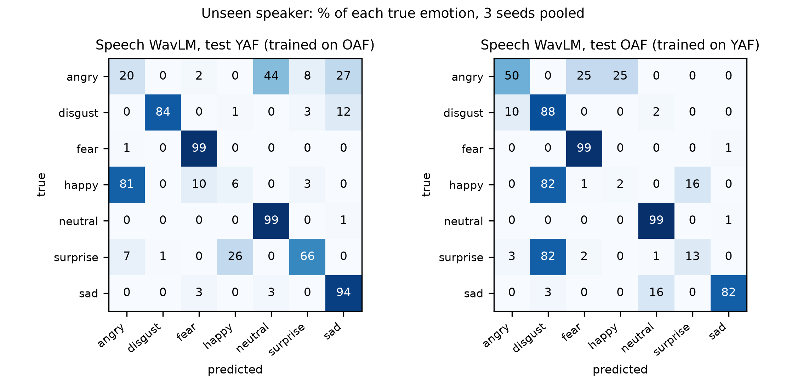
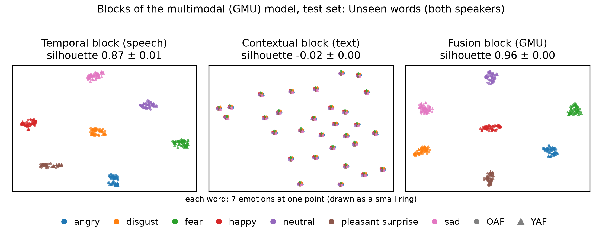
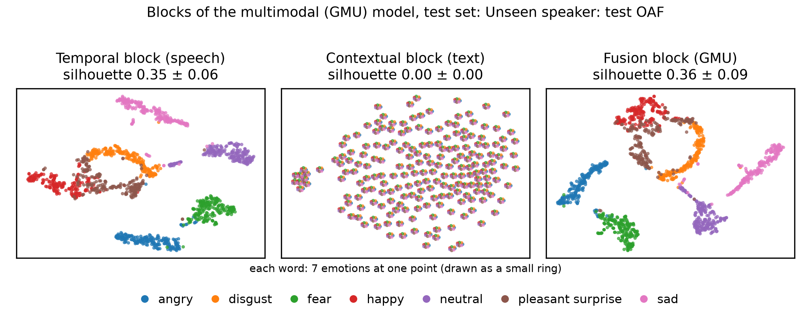

**Repository:** <https://github.com/sudarshan032/ltrc-assignment2-alignment-emotion> (folder `2b_emotion_recognition/`: code in the required layout, setup, all results). **Data:** TESS, <https://www.kaggle.com/datasets/ejlok1/toronto-emotional-speech-set-tess>.

# 1. Summary

Three systems classify 7 emotions from **speech only**, **text only** and **speech + text**. Each follows the five blocks of the brief, with frozen pretrained encoders (WavLM, BERT) as the main models and from-scratch baselines (MFCC, learned word embeddings).

* **Speech carries the emotion:** 100 % on unseen words, 64 % on an unseen speaker.
* **Text carries none, by construction:** every TESS transcript is "Say the word ___", recorded in all 7 emotions, so any text model scores exactly 1/7 = **14.3 %**.
* **Fusion cannot help on TESS:** the trained fusion models give the same accuracy when their text input is shuffled or held constant.
* **Easiest:** fear, neutral, sad, disgust. **Hardest:** happy, then angry and pleasant surprise: the high-arousal emotions the two speakers express differently.

# 2. Data and test conditions

TESS: 2 female speakers (OAF, 64 years; YAF, 26 years) × 200 words × 7 emotions = 2,800 clips of "Say the word ___", 400 per emotion. TESS has no transcript files: the text input is built from the file name as "Say the word <word>". A random clip split would put the same word and speaker, in another emotion, in both train and test, so three stricter splits are used, fixed for all models:

| Condition | Train | Validation | Test | Measures |
|---|---|---|---|---|
| **Unseen words** | 140 words, both speakers (1,960) | 30 words (420) | 30 words (420) | new words, known voices |
| **Unseen speaker** (×2 directions) | one speaker, 170 words (1,190) | same speaker, 30 words (210) | all 1,400 clips of the other speaker | a new voice |

Each model is trained with 3 seeds (initialization and batch order); results are mean ± std. In the main experiments the test speaker is never used for any decision (§5.5 adds experiments that do, and says so).

# 3. Architecture decisions

| Block | Speech | Text |
|---|---|---|
| 1. Preprocessing | 16 kHz mono, trim silence (30 dB), per-clip normalization; variable length kept (padding + mask) | lowercase, strip punctuation, WordPiece tokens |
| 2. Feature extraction | **WavLM-base-plus**, frozen, learned mix of its 13 layers → T × 768. Baseline: 40 MFCC + Δ + ΔΔ → T × 120 | **BERT-base**, frozen, learned layer mix → tokens × 768. Baseline: word embeddings learned on TESS |
| 3. Temporal / contextual | 2-layer **BiLSTM** + attention pooling → 256-d | 2-layer **Transformer** + attention pooling → 256-d |
| 4. Fusion | **Gated multimodal unit** (GMU): h = z ⊙ tanh(Wss) + (1 − z) ⊙ tanh(Wtt), z = σ(Wz[s; t]). Ablation: concatenation | |
| 5. Classifier | MLP 256 → 128 → 7 | same |

**Why.**

1. *Preprocessing.* 16 kHz is WavLM's rate and keeps the prosodic cues; nothing is cut or stretched. Text needs only light cleaning: the sentences are fixed ("Say the word …") and BERT's tokenizer handles the rest.
2. *Features.* 2,800 clips cannot train an encoder. WavLM (94k h, thousands of speakers) already encodes prosody and voice quality, BERT word meaning in context. Both are frozen, which avoids overfitting ~100 M weights and lets features be cached; the learned layer mix picks the useful layers. The from-scratch baselines show what pretraining adds.
3. *Sequence models.* Emotion unfolds over the utterance (pitch contour, rate); a small BiLSTM (~1 M weights) models a sequence of 50–250 frames on little data. A Transformer relates every token to every other, which is what "meaning in context" needs; 2 layers suffice for 6 tokens. Attention pooling lets informative frames (the target word) weigh more.
4. *Fusion.* A learned gate can weight the more reliable modality and switch off a useless one; late fusion because speech frames and text tokens are not aligned.
5. *Classifier.* One hidden layer is enough on top of a 256-d representation; kept small to avoid overfitting a single training speaker.

**Training:** AdamW (lr 10⁻³), batch 32, label smoothing 0.05, one-cycle schedule over a fixed 15 epochs; the final weights are used. No early stopping: in the unseen-speaker condition validation is the training speaker, which reaches ≥ 98 % within 2–4 epochs (`Results/plots/training_curves.png`), so it cannot choose an epoch that transfers.

# 4. Experiments: speech-only, text-only, multimodal

Test accuracy (%), mean ± std over 3 seeds; chance = 14.3 %. Macro-F1 follows the same pattern (`Results/RESULTS.md`).

| Model | Unseen words | Unseen speaker: test OAF | test YAF | Unseen speaker (mean) |
|---|---|---|---|---|
| **Speech: WavLM + BiLSTM** | **100.0 ± 0.0** | **61.8 ± 3.5** | **66.8 ± 7.8** | **64.3** |
| Speech: MFCC + BiLSTM (scratch) | 99.9 ± 0.1 | 39.3 ± 9.8 | 47.0 ± 3.7 | 43.2 |
| Speech: 16 prosody features + logistic regression | 88.8 | 51.1 | 52.4 | 51.8 |
| Text: BERT + Transformer | 14.3 ± 0.0 | 14.3 ± 0.0 | 14.3 ± 0.0 | 14.3 |
| Text: word emb. + Transformer (scratch) | 14.3 ± 0.0 | 14.3 ± 0.0 | 14.3 ± 0.0 | 14.3 |
| Fusion: WavLM + BERT, GMU | 100.0 ± 0.0 | 55.7 ± 7.0 | 66.1 ± 1.8 | 60.9 |
| Fusion: WavLM + BERT, concat | 100.0 ± 0.0 | 56.0 ± 3.9 | 57.2 ± 9.3 | 56.6 |
| Fusion: MFCC + word emb., GMU (scratch) | 99.6 ± 0.1 | 36.1 ± 10.7 | 48.8 ± 6.8 | 42.5 |

* **Speech.** Unseen words are near 100 % for every speech model: both voices are known, and each clip also contains "Say the word" spoken in the same emotion, so this is close to within-speaker classification. The **unseen speaker is the real test**: with one training speaker a model cannot separate "how she sounds" from "how she sounds when angry". WavLM, pretrained on thousands of speakers, transfers far better than MFCCs (+21 points). A reference without deep learning, 16 pitch, energy, duration and spectral-shape statistics with logistic regression (`prosody_baseline.py`, deterministic), is worse on unseen words but above the MFCC BiLSTM on the unseen speaker: coarse prosody transfers between voices better than detailed spectra learned from one voice. Seed variance is high (std up to ± 10.7), so differences under about 10 points between unseen-speaker models are not reliable.
* **Text.** Exactly 14.3 % in every run. For a given speaker the 7 clips of a word have the same transcript, so a text model gives them one answer, right for exactly 1 of 7. The BERT model collapses to (nearly) a single class (macro-F1 ≈ 4 %) and its loss stays at ln 7.
* **Multimodal.** Equal to speech on unseen words. On the unseen speaker, GMU fusion is 6.1 points below speech on test OAF and 0.7 below on test YAF; concatenation 5.8 and 9.6 below. These gaps are of the size of the seed std (up to ± 9.3), so not reliable; concatenation on test YAF is borderline. §5.2 shows why fusion cannot gain here.

# 5. Analysis

## 5.1 Easiest and hardest emotions

Recall per emotion on the unseen speaker (both directions, 3 seeds). On unseen words every emotion is 99–100 %.

| Model | angry | disgust | fear | happy | neutral | pl. surprise | sad |
|---|---|---|---|---|---|---|---|
| Speech: WavLM | 35 | 86 | 99 | 4 | 99 | 40 | 88 |
| Speech: MFCC | 55 | 54 | 65 | 0 | 78 | 4 | 46 |
| Fusion: GMU | 28 | 78 | 95 | 3 | 93 | 51 | 79 |

**Why.** An emotion should transfer to a new speaker if both speakers express it the same way. Mean pitch, pitch range (5th–95th percentile) and duration per speaker and emotion (all 200 clips per cell; `Results/acoustic_stats.csv`). Loudness is not used: every clip is normalized before the model sees it.

| Emotion | Mean F0 (Hz) OAF / YAF | F0 range (Hz) OAF / YAF | Duration (s) OAF / YAF |
|---|---|---|---|
| angry | 257 / 242 | 118 / 146 | 1.48 / 2.04 |
| disgust | 189 / 220 | 116 / 192 | 2.31 / 2.39 |
| fear | 297 / 322 | 89 / 172 | 1.54 / 1.62 |
| happy | 263 / 281 | 274 / 190 | 1.97 / 1.67 |
| neutral | 188 / 194 | 35 / 19 | 2.01 / 2.03 |
| pleasant surprise | 224 / 323 | 209 / 329 | 2.00 / 1.88 |
| sad | 202 / 217 | 153 / 115 | 2.52 / 2.17 |

To test how far these three features explain the model, each emotion of the test speaker was matched to the training speaker's nearest emotion (z-scored means) and compared with the speech WavLM model's most frequent prediction (`Results/acoustic_nearest.csv`). They agree in **5 of 14** cases:

* **Explained by prosody:** fear (high and short for both speakers) and neutral (nearly flat for both: range 35 / 19 Hz, every other emotion ≥ 89 Hz) are recognized at 99 % and are their own nearest match in both directions. YAF's happy (281 Hz, 1.67 s) is nearest to OAF's angry (257 Hz, 1.48 s), and 81 % of it is called **angry**.
* **Recognized, but not by these features:** disgust and sad are recognized well (86 % and 88 %), although by pitch and duration each is nearest to the other speaker's sad or disgust. WavLM uses cues beyond these three (e.g. voice quality), which this analysis cannot isolate.
* **Wrong, and not explained by prosody:** on test OAF, 82 % of her happy and 82 % of her pleasant-surprise clips are called **disgust**, and 36 % of all OAF predictions are disgust (14 % expected). By prosody her happy is nearest YAF's happy and her surprise nearest YAF's angry, not disgust: this is a speaker-level bias of the learned space, not a pitch or tempo effect. Likewise YAF's angry goes to neutral (44 %) and sad (27 %).

{width=82%}

## 5.2 When does fusion help most?

Fusion helps only when the second modality adds information. Each trained fusion model was re-tested with its text input shuffled across clips, and replaced by one fixed sentence (`text_ablation.py`):

| Test | Normal (GMU / concat) | Text shuffled | Text constant |
|---|---|---|---|
| Unseen words | 100 / 100 | 100 / 100 | 100 / 100 |
| Unseen speaker: test OAF | 55.7 / 56.0 | 55.7 / 56.0 | 55.7 / 55.9 |
| Unseen speaker: test YAF | 66.1 / 57.2 | 66.1 / 57.2 | 66.1 / 56.7 |

* **The fusion models ignore the text** (largest single-model change 1.4 points). Inside the GMU, the text term (1 − z) ⊙ tanh(Wtt) accounts for at most 0.3 % of the across-clip variance of the fused vector (`fusion_blocks.py`, `Results/fusion_blocks.csv`): it is a near-constant offset, and the gate value (z ≈ 0.9) does not mean a 10 % text contribution. The gate also does not adapt per clip: its mean varies by at most 0.007 across the clips of a run (`speech_gate` in `Results/runs/*_predictions.csv`), so the per-clip weighting that motivated the GMU (§3) never happens on TESS.
* **So on TESS fusion cannot help**; GMU, concatenation and speech-only are effectively three differently initialized speech models, and their gaps are seed noise. Learning to ignore an uninformative modality is the correct behaviour.
* **Where fusion would help most:** data whose words carry emotion (IEMOCAP, MELD, spontaneous speech), in exactly TESS's hardest cases. "I'm so glad" vs "I'm so angry" separates happy from angry when the voice is equally excited, and words don't depend on the speaker, so text would help most for a new speaker. This is argued, not shown: TESS cannot test it.

## 5.3 Error analysis: failure cases

The five most frequent confusions of GMU fusion on the unseen speaker (both directions, 3 seeds pooled), each with the clip that gets that wrong label most consistently (`Results/failure_cases.csv`). Stats: *the clip / her average for the true emotion*; last column: the training speaker's emotion nearest to this clip in pitch, range and duration.

| Confusion (errors, 3 seeds) | Clip | Wrong in seeds (fusion / speech-only) | Mean F0 (Hz) | F0 range (Hz) | Duration (s) | Nearest by prosody |
|---|---|---|---|---|---|---|
| happy → angry (556) | YAF_love_happy | 3/3 / 3/3 | 282 / 281 | 192 / 190 | 1.41 / 1.67 | **angry** |
| angry → fear (443) | OAF_hash_angry | 3/3 / 2/3 | 270 / 257 | 53 / 118 | 1.63 / 1.48 | happy |
| pl. surprise → disgust (348) | OAF_time_ps | 3/3 / 3/3 | 233 / 224 | 225 / 209 | 2.14 / 2.00 | **disgust** |
| happy → disgust (345) | OAF_dime_happy | 3/3 / 3/3 | 269 / 263 | 277 / 274 | 1.89 / 1.97 | happy |
| angry → neutral (311) | YAF_pick_angry | 3/3 / 2/3 | 242 / 242 | 60 / 146 | 2.02 / 2.04 | **neutral** |

1. **YAF happy → angry:** short and high like OAF's angry, the only short, excited class the model learned; prosody predicts it.
2. **OAF angry → fear:** a very flat angry (53 vs 118 Hz range); prosody points to happy, not fear, so the cue is elsewhere.
3. **OAF surprise → disgust:** slightly long for her surprise; prosody also puts it nearest YAF's disgust.
4. **OAF happy → disgust:** a typical OAF happy in every feature, nearest YAF's happy, yet called disgust: the speaker-level disgust bias of §5.1, not a property of the clip.
5. **YAF angry → neutral:** a flat angry (60 vs 146 Hz range) at her usual pitch; prosody puts it nearest OAF's neutral.

Pitch and duration explain 3 of the 5 (cases 1, 3, 5). All five errors are made in every fusion seed and by speech-only too, so they are acoustic transfer errors, not caused by the text; on unseen words there are no errors in 1,260 test clips.

## 5.4 Separability of the learned representations

The three blocks of the **multimodal (GMU) model**, as in the brief's figure: its speech temporal block, its text contextual block and its fusion block, on the test clips (`fusion_blocks.py`). Silhouette on the 256-d vectors, true emotion as label (1 = tight separate clusters, 0 = overlap), mean ± std over 3 seeds; t-SNE of seed 0.

| Block of the GMU model | Unseen words | Unseen speaker: test YAF | test OAF |
|---|---|---|---|
| Temporal (speech BiLSTM) | 0.87 ± 0.01 | 0.48 ± 0.02 | 0.35 ± 0.06 |
| Contextual (text Transformer) | −0.02 ± 0.00 | 0.00 ± 0.00 | 0.00 ± 0.00 |
| Fusion (GMU output) | 0.96 ± 0.00 | 0.49 ± 0.03 | 0.36 ± 0.09 |

{width=82%}

{width=82%}

* **Temporal:** 7 clean emotion clusters on unseen words, both speakers inside each; on a new speaker still visible but looser.
* **Contextual:** no emotion structure; all 7 emotions of a word map to the same point.
* **Fusion:** close to the temporal block, as expected when the text term is a constant (§5.2); on unseen words the extra layer tightens the clusters.
* **Separable is not the same as correct:** on test YAF the clusters are clear (0.48), yet a third of the clips are misclassified, because whole clusters fall in the wrong emotion's region (her happy where OAF's angry was learned; plot: `Results/plots/tsne_unseen_speaker_YAF.png`). §5.5 tests this directly.

## 5.5 Additional experiment: does a little data from the new speaker fix it?

The encoder of each trained speech model is kept frozen and only a linear classifier is refit on k labelled clips per emotion of the new speaker, then tested on her other clips (`fewshot.py`; both directions, 3 seeds, 20 random draws).

| Labelled clips per emotion | 0 (zero-shot) | 1 | 5 | 20 |
|---|---|---|---|---|
| Speech: WavLM | 64.3 | 81.9 | 92.4 | 96.8 |
| Speech: MFCC | 43.2 | 62.8 | 85.4 | 93.1 |

One clip per emotion recovers most of the gap: the new speaker's emotions are already linearly separable in the learned space, only the boundaries learned from the other speaker are off.
