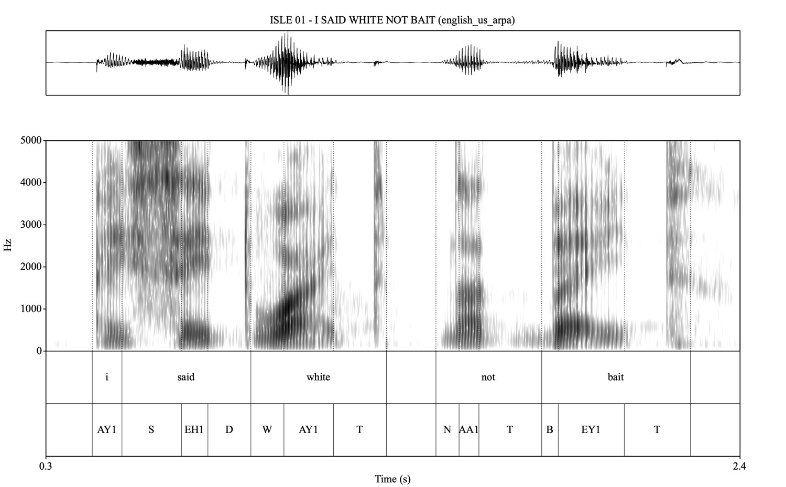
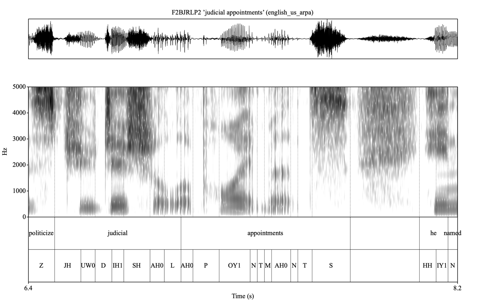
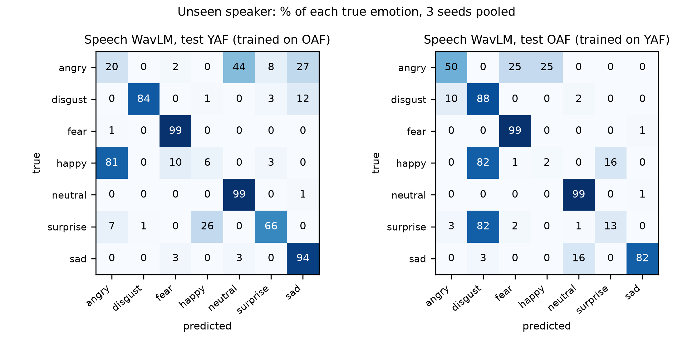
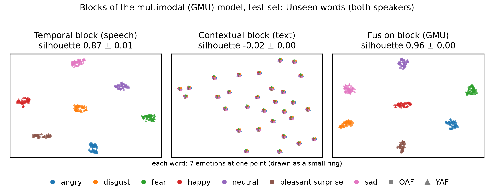
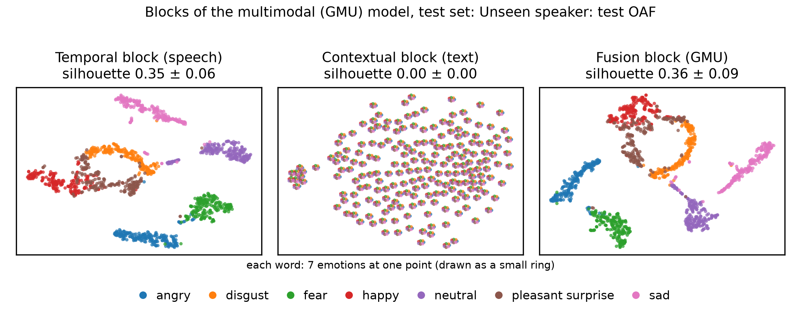

**Repository:** <https://github.com/sudarshan032/ltrc-assignment2-alignment-emotion>. Part A (2a) is in `2a_forced_alignment/`, part B (2b) in `2b_emotion_recognition/`.

# Part A (2a): Forced Alignment with the Montreal Forced Aligner

Versions: MFA 3.4.4 (Kaldi), english_us_arpa 3.0.0a2, english_mfa 3.1.0, Praat 7.0.03.

## A1. Summary

The six recordings (97.2 s, 244 words, 2 speakers) were aligned at word and phone level with MFA 3.4.4, using the pretrained `english_us_arpa` model and a corpus dictionary whose missing words come from a G2P model trained here. Five more runs test other acoustic models and settings.

* **The pretrained aligner is close to hand-corrected boundaries:** on the 3 ISLE files, 67 % of word and 77 % of phone boundaries are within 20 ms of the hand labels, 91–96 % within 50 ms (small sample and caveats in §A5).
* **Fine-tuning and adaptation change almost nothing:** fine-tuning only re-places the existing boundaries, and 97 s of adaptation data barely moves a model trained on 982 hours of 2,485 speakers.
* **A second pretrained model (IPA) agrees** on 94 % of word boundaries within 20 ms.
* **Training from scratch on 97 s fails** (boundaries off by about 1 s).
* **Typical errors:** dropped sounds are squeezed instead of skipped; fast spelled acronyms are compressed; the aligner labels what the transcript says, not what was said.

## A2. Data and preparation

| Files | Speaker | Duration | Content |
|---|---|---|---|
| F2BJRLP1–3 | f2b, BU Radio News Corpus (American announcer) | 25.3 / 28.6 / 30.7 s | news story |
| ISLE_…_01–03 | ISLE corpus, L2 English learner | 4.1 / 3.9 / 4.5 s | "I SAID WHITE NOT BAIT", "… NEW NOT NO", "… BAD NOT BED" |

* The three F2B files are **NIST SPHERE** files with a `.wav` name. MFA reads them, but most tools do not, so `prepare_corpus.py` rewrites them as standard WAV (samples unchanged).
* Transcripts: line breaks and repeated spaces removed; "seventy- six" (hyphen + space) → "seventy six"; spelled-out acronyms split into letters ("WBUR's" → "W B U R's").
* Layout as MFA requires: one folder per speaker, each WAV with a same-named `.lab` transcript.

## A3. Dictionary and G2P

Every corpus word is taken from the `english_us_arpa` lexicon (all variants kept). Four words are missing (*dukakis, maffy, melnicove, politicize*; MFA splits the transcript's "de-politicize" at the hyphen); their pronunciations come from a **G2P model trained on the lexicon** with `mfa train_g2p`. Tested on 2,000 random words held out from its training, it has a **7.9 % phone error rate** (30.1 % of words have at least one error, 24.2 % ignoring stress). For the IPA run, the `english_us_mfa` lexicon also lacks *judgeships* and *margo*; all six come from MFA's pretrained IPA G2P.

| Word | Own G2P (identical to MFA's pretrained G2P) |
|---|---|
| dukakis | D UW1 K AA1 K IH0 S |
| maffy | M AE1 F IY0 |
| melnicove | M EH1 L N IH0 K OW2 V |
| politicize | P AH0 L IH1 T IH0 S AY2 Z |

Both G2P models give the same pronunciations, so the alignment does not depend on which is used. "Dukakis" gets a stressed, full first vowel (UW1) where the name has an unstressed one (CMUdict: D UW0 K AA1 K IH0 S); that vowel is aligned at only 30 ms at 15.51 s of F2BJRLP1. The G2P output was kept unedited, so the runs show what the G2P really gives.

## A4. Alignment runs

| Run | Acoustic model | Dictionary | Question |
|---|---|---|---|
| `arpa` (main) | `english_us_arpa` (pretrained) | corpus ARPAbet + own G2P | does a pretrained aligner work here? |
| `arpa_finetune` | same, `--fine_tune` | same | does boundary refinement help? |
| `arpa_adapted` | `english_us_arpa` adapted (MAP) to the 6 files | same | does fitting these voices help? |
| `mfa_ipa` | `english_mfa` (pretrained, IPA phones) | corpus IPA | does an independent model agree? |
| `scratch` | trained from scratch on the 6 files | corpus ARPAbet | how much data does an aligner need? |
| `arpa_reduced` | `english_us_arpa` | + variants without /t/ after /n/ | can the aligner skip an unreleased /t/? |

| Run | Phones ≤ 30 ms | Word boundaries within 20 ms of `arpa`* |
|---|---|---|
| `arpa` (main) | 7.9 % | – |
| `arpa_finetune` / `arpa_adapted` / `arpa_reduced` | 7.8 / 7.8 / 7.7 % | 100 % (mean shift 0.1–0.2 ms) |
| `mfa_ipa` | 9.4 % | 94.1 % (mean 18 ms) |
| `scratch` (5 files; ISLE 01 failed) | 65.6 % (mostly single 10 ms frames) | 5.0 % (mean 1 s) |

\* Every word's start and end time is compared, so a boundary shared by two adjacent words counts twice (§A5 counts each distinct boundary once).

* **Fine-tuning** (`--fine_tune` re-places each boundary with a finer search; nothing is trained) moved only 8 phone boundaries. **Adaptation** raises the log-likelihood on the same 6 files (−47.75 → −46.76) but barely moves the alignment (9 phone boundaries shift by 10–20 ms).
* **The IPA model** differs mainly at pauses: in ISLE 01 `english_us_arpa` puts a 150 ms silence between "white" and "not", `english_mfa` gives it to the closure of the final /t/.
* **The scratch model** cannot align ISLE 01 with the default beam; with a 10× wider beam (`outputs/scratch_widebeam/`) it aligns it, but stretches "said" over 1.84 s: the model fails, not the search.

{width=85%}

## A5. Accuracy against hand-labelled boundaries

The 3 ISLE files (12.5 s, 15 words, 38 phones) were labelled by hand, starting from the main run's TextGrids: each boundary was checked by ear and on the spectrogram and moved where needed. Every run is scored against these labels, each distinct boundary counted once (`scripts/evaluate_manual.py`).

| Run | Tier | Boundaries | Mean error | Median | Within 20 ms | Within 50 ms |
|---|---|---|---|---|---|---|
| `arpa`, `arpa_finetune`, `arpa_adapted`, `arpa_reduced` | words | 21 | 17.8 ms | 10 ms | 66.7 % | 90.5 % |
| | phones | 44 | 10.8–11.0 ms | 0 ms | 77.3 % | 95.5 % |
| `mfa_ipa` | words | 21 | 242 ms | 20 ms | 52.4 % | 71.4 % |
| `scratch` (2 files) | words | 14 | 1026 ms | 447 ms | 0 % | 0 % |
| | phones | 29 | 1228 ms | 1580 ms | 0 % | 3.4 % |

* **Main run.** Errors over 30 ms: two at stops (the closure before "bait", 78 ms; the /b/ release into /æ/ in "bad", 41 ms), two at vowel ends, where the aligner keeps the fading vowel longer (utterance-final "no" 76 ms; "new" before a pause 39 ms), and one at the onset of /s/ in "said" (34 ms).
* **IPA model.** Median 20 ms, but in 2 of the 3 files it extends the final word to the end of the recording instead of ending it at the silence (errors up to 2.5 s). Its phones are not scored: they are IPA, the hand labels ARPAbet.
* **Limits.** One annotator (the author), 12.5 s of one L2 speaker, and labels corrected starting from the main run's own output, which biases the reference toward that run: 15 of 21 word and 19 of 44 phone boundaries were moved, the other phone boundaries were judged correct and kept (hence the 0 ms median). With 21 word boundaries one boundary is 4.8 points, and a full re-run of the pipeline moves a few boundaries by 10 ms (main run 61.9–66.7 % words, 75.0–77.3 % phones within 20 ms; mean phone error 10.8–11.7 ms). The numbers indicate accuracy; they are not a benchmark.

## A6. Observations

**How boundaries are placed.** On 10 ms frame edges. A word starts where its first phone starts; pauses become empty intervals. Stops are split at the closure: the silent closure belongs to the stop and the burst is at its end ("said", "white", "bait").

**Errors and mismatches.**

1. **Dropped sounds are squeezed, not skipped.** The full dictionary pronunciation must be aligned, so a sound the speaker didn't produce gets the shortest slot the model allows (usually 3 frames, 30 ms; for some phones one 10 ms frame). 84 phones (7.9 %) are ≤ 30 ms. Clear deletions are the unreleased /t/ after /n/ in "appointment(s)" and "important"; many others are reduced vowels in fast speech. Offering variants without each such /t/ (`arpa_reduced`) did not help: the aligner chose one in only 1 of 7 tokens. A likely reason (not tested) is that the pretrained model has learned the silent closure in /n_m/ as /t/; pronunciation probabilities estimated from data (`mfa train_dictionary`) might change the choice.

{width=78%}

2. **Spelled acronyms are compressed.** "W" in "WBUR" has 7 dictionary phones; the letter lasts 340 ms, its first five phones share 180 ms, and AH0 gets a single 10 ms frame.
3. **The aligner follows the transcript, not the speech.** The L2 speaker's "bad" and "bed" vowels are close (F1 598 vs 530 Hz) but are labelled AE1 and EH1, as the transcript says: alignment gives timing, not a pronunciation judgement.

# Part B (2b): Multimodal Emotion Recognition on TESS

**Data:** TESS, <https://www.kaggle.com/datasets/ejlok1/toronto-emotional-speech-set-tess>.

## B1. Summary

Three systems classify 7 emotions from **speech only**, **text only** and **speech + text**. Each follows the five blocks of the brief, with frozen pretrained encoders (WavLM, BERT) as the main models and from-scratch baselines (MFCC, learned word embeddings).

* **Speech carries the emotion:** 100 % on unseen words, 64 % on an unseen speaker.
* **Text carries none, by construction:** every TESS transcript is "Say the word ___", recorded in all 7 emotions, so any text model scores exactly 1/7 = **14.3 %**.
* **Fusion cannot help on TESS:** the trained fusion models give the same accuracy when their text input is shuffled or held constant.
* **Easiest:** fear, neutral, sad, disgust. **Hardest:** happy, then angry and pleasant surprise: the high-arousal emotions the two speakers express differently.

## B2. Data and test conditions

TESS: 2 female speakers (OAF, 64 years; YAF, 26 years) × 200 words × 7 emotions = 2,800 clips of "Say the word ___", 400 per emotion. TESS has no transcript files: the text input is built from the file name as "Say the word <word>". A random clip split would put the same word and speaker, in another emotion, in both train and test, so three stricter splits are used, fixed for all models:

| Condition | Train | Validation | Test | Measures |
|---|---|---|---|---|
| **Unseen words** | 140 words, both speakers (1,960) | 30 words (420) | 30 words (420) | new words, known voices |
| **Unseen speaker** (×2 directions) | one speaker, 170 words (1,190) | same speaker, 30 words (210) | all 1,400 clips of the other speaker | a new voice |

Each model is trained with 3 seeds (initialization and batch order); results are mean ± std. In the main experiments the test speaker is never used for any decision (§B5.5 adds experiments that do, and says so).

## B3. Architecture decisions

| Block | Speech | Text |
|---|---|---|
| 1. Preprocessing | 16 kHz mono, trim silence (30 dB), per-clip normalization; variable length kept (padding + mask) | lowercase, strip punctuation, WordPiece tokens |
| 2. Feature extraction | **WavLM-base-plus**, frozen, learned mix of its 13 layers → T × 768. Baseline: 40 MFCC + Δ + ΔΔ → T × 120 | **BERT-base**, frozen, learned layer mix → tokens × 768. Baseline: word embeddings learned on TESS |
| 3. Temporal / contextual | 2-layer **BiLSTM** + attention pooling → 256-d | 2-layer **Transformer** + attention pooling → 256-d |
| 4. Fusion | **Gated multimodal unit** (GMU): h = z ⊙ tanh(Wss) + (1 − z) ⊙ tanh(Wtt), z = σ(Wz[s; t]). Ablation: concatenation | |
| 5. Classifier | MLP 256 → 128 → 7 | same |

**Why.**

1. *Preprocessing.* 16 kHz is WavLM's rate and keeps the prosodic cues; nothing is cut or stretched. Text needs only light cleaning: the sentences are fixed ("Say the word …") and BERT's tokenizer handles the rest.
2. *Features.* 2,800 clips cannot train an encoder. WavLM (94k h, thousands of speakers) already encodes prosody and voice quality, BERT word meaning in context. Both are frozen, which avoids overfitting ~100 M weights and lets features be cached; the learned layer mix picks the useful layers. The from-scratch baselines show what pretraining adds.
3. *Sequence models.* Emotion unfolds over the utterance (pitch contour, rate); a small BiLSTM (~1 M weights) models a sequence of 50–250 frames on little data. A Transformer relates every token to every other, which is what "meaning in context" needs; 2 layers suffice for 6 tokens. Attention pooling lets informative frames (the target word) weigh more.
4. *Fusion.* A learned gate can weight the more reliable modality and switch off a useless one; late fusion because speech frames and text tokens are not aligned.
5. *Classifier.* One hidden layer is enough on top of a 256-d representation; kept small to avoid overfitting a single training speaker.

**Training:** AdamW (lr 10⁻³), batch 32, label smoothing 0.05, one-cycle schedule over a fixed 15 epochs; the final weights are used. No early stopping: in the unseen-speaker condition validation is the training speaker, which reaches ≥ 98 % within 2–4 epochs (`Results/plots/training_curves.png`), so it cannot choose an epoch that transfers.

## B4. Experiments: speech-only, text-only, multimodal

Test accuracy (%), mean ± std over 3 seeds; chance = 14.3 %. Macro-F1 follows the same pattern (`Results/RESULTS.md`).

| Model | Unseen words | Unseen speaker: test OAF | test YAF | Unseen speaker (mean) |
|---|---|---|---|---|
| **Speech: WavLM + BiLSTM** | **100.0 ± 0.0** | **61.8 ± 3.5** | **66.8 ± 7.8** | **64.3** |
| Speech: MFCC + BiLSTM (scratch) | 99.9 ± 0.1 | 39.3 ± 9.8 | 47.0 ± 3.7 | 43.2 |
| Speech: 16 prosody features + logistic regression | 88.8 | 51.1 | 52.4 | 51.8 |
| Text: BERT + Transformer | 14.3 ± 0.0 | 14.3 ± 0.0 | 14.3 ± 0.0 | 14.3 |
| Text: word emb. + Transformer (scratch) | 14.3 ± 0.0 | 14.3 ± 0.0 | 14.3 ± 0.0 | 14.3 |
| Fusion: WavLM + BERT, GMU | 100.0 ± 0.0 | 55.7 ± 7.0 | 66.1 ± 1.8 | 60.9 |
| Fusion: WavLM + BERT, concat | 100.0 ± 0.0 | 56.0 ± 3.9 | 57.2 ± 9.3 | 56.6 |
| Fusion: MFCC + word emb., GMU (scratch) | 99.6 ± 0.1 | 36.1 ± 10.7 | 48.8 ± 6.8 | 42.5 |

* **Speech.** Unseen words are near 100 % for every speech model: both voices are known, and each clip also contains "Say the word" spoken in the same emotion, so this is close to within-speaker classification. The **unseen speaker is the real test**: with one training speaker a model cannot separate "how she sounds" from "how she sounds when angry". WavLM, pretrained on thousands of speakers, transfers far better than MFCCs (+21 points). A reference without deep learning, 16 pitch, energy, duration and spectral-shape statistics with logistic regression (`prosody_baseline.py`, deterministic), is worse on unseen words but above the MFCC BiLSTM on the unseen speaker: coarse prosody transfers between voices better than detailed spectra learned from one voice. Seed variance is high (std up to ± 10.7), so differences under about 10 points between unseen-speaker models are not reliable.
* **Text.** Exactly 14.3 % in every run. For a given speaker the 7 clips of a word have the same transcript, so a text model gives them one answer, right for exactly 1 of 7. The BERT model collapses to (nearly) a single class (macro-F1 ≈ 4 %) and its loss stays at ln 7.
* **Multimodal.** Equal to speech on unseen words. On the unseen speaker, GMU fusion is 6.1 points below speech on test OAF and 0.7 below on test YAF; concatenation 5.8 and 9.6 below. These gaps are of the size of the seed std (up to ± 9.3), so not reliable; concatenation on test YAF is borderline. §B5.2 shows why fusion cannot gain here.

## B5. Analysis

### B5.1 Easiest and hardest emotions

Recall per emotion on the unseen speaker (both directions, 3 seeds). On unseen words every emotion is 99–100 %.

| Model | angry | disgust | fear | happy | neutral | pl. surprise | sad |
|---|---|---|---|---|---|---|---|
| Speech: WavLM | 35 | 86 | 99 | 4 | 99 | 40 | 88 |
| Speech: MFCC | 55 | 54 | 65 | 0 | 78 | 4 | 46 |
| Fusion: GMU | 28 | 78 | 95 | 3 | 93 | 51 | 79 |

**Why.** An emotion should transfer to a new speaker if both speakers express it the same way. Mean pitch, pitch range (5th–95th percentile) and duration per speaker and emotion (all 200 clips per cell; `Results/acoustic_stats.csv`). Loudness is not used: every clip is normalized before the model sees it.

| Emotion | Mean F0 (Hz) OAF / YAF | F0 range (Hz) OAF / YAF | Duration (s) OAF / YAF |
|---|---|---|---|
| angry | 257 / 242 | 118 / 146 | 1.48 / 2.04 |
| disgust | 189 / 220 | 116 / 192 | 2.31 / 2.39 |
| fear | 297 / 322 | 89 / 172 | 1.54 / 1.62 |
| happy | 263 / 281 | 274 / 190 | 1.97 / 1.67 |
| neutral | 188 / 194 | 35 / 19 | 2.01 / 2.03 |
| pleasant surprise | 224 / 323 | 209 / 329 | 2.00 / 1.88 |
| sad | 202 / 217 | 153 / 115 | 2.52 / 2.17 |

To test how far these three features explain the model, each emotion of the test speaker was matched to the training speaker's nearest emotion (z-scored means) and compared with the speech WavLM model's most frequent prediction (`Results/acoustic_nearest.csv`). They agree in **5 of 14** cases:

* **Explained by prosody:** fear (high and short for both speakers) and neutral (nearly flat for both: range 35 / 19 Hz, every other emotion ≥ 89 Hz) are recognized at 99 % and are their own nearest match in both directions. YAF's happy (281 Hz, 1.67 s) is nearest to OAF's angry (257 Hz, 1.48 s), and 81 % of it is called **angry**.
* **Recognized, but not by these features:** disgust and sad are recognized well (86 % and 88 %), although by pitch and duration each is nearest to the other speaker's sad or disgust. WavLM uses cues beyond these three (e.g. voice quality), which this analysis cannot isolate.
* **Wrong, and not explained by prosody:** on test OAF, 82 % of her happy and 82 % of her pleasant-surprise clips are called **disgust**, and 36 % of all OAF predictions are disgust (14 % expected). By prosody her happy is nearest YAF's happy and her surprise nearest YAF's angry, not disgust: this is a speaker-level bias of the learned space, not a pitch or tempo effect. Likewise YAF's angry goes to neutral (44 %) and sad (27 %).

{width=82%}

### B5.2 When does fusion help most?

Fusion helps only when the second modality adds information. Each trained fusion model was re-tested with its text input shuffled across clips, and replaced by one fixed sentence (`text_ablation.py`):

| Test | Normal (GMU / concat) | Text shuffled | Text constant |
|---|---|---|---|
| Unseen words | 100 / 100 | 100 / 100 | 100 / 100 |
| Unseen speaker: test OAF | 55.7 / 56.0 | 55.7 / 56.0 | 55.7 / 55.9 |
| Unseen speaker: test YAF | 66.1 / 57.2 | 66.1 / 57.2 | 66.1 / 56.7 |

* **The fusion models ignore the text** (largest single-model change 1.4 points). Inside the GMU, the text term (1 − z) ⊙ tanh(Wtt) accounts for at most 0.3 % of the across-clip variance of the fused vector (`fusion_blocks.py`, `Results/fusion_blocks.csv`): it is a near-constant offset, and the gate value (z ≈ 0.9) does not mean a 10 % text contribution. The gate also does not adapt per clip: its mean varies by at most 0.007 across the clips of a run (`speech_gate` in `Results/runs/*_predictions.csv`), so the per-clip weighting that motivated the GMU (§B3) never happens on TESS.
* **So on TESS fusion cannot help**; GMU, concatenation and speech-only are effectively three differently initialized speech models, and their gaps are seed noise. Learning to ignore an uninformative modality is the correct behaviour.
* **Where fusion would help most:** data whose words carry emotion (IEMOCAP, MELD, spontaneous speech), in exactly TESS's hardest cases. "I'm so glad" vs "I'm so angry" separates happy from angry when the voice is equally excited, and words don't depend on the speaker, so text would help most for a new speaker. This is argued, not shown: TESS cannot test it.

### B5.3 Error analysis: failure cases

The five most frequent confusions of GMU fusion on the unseen speaker (both directions, 3 seeds pooled), each with the clip that gets that wrong label most consistently (`Results/failure_cases.csv`). Stats: *the clip / her average for the true emotion*; last column: the training speaker's emotion nearest to this clip in pitch, range and duration.

| Confusion (errors, 3 seeds) | Clip | Wrong in seeds (fusion / speech-only) | Mean F0 (Hz) | F0 range (Hz) | Duration (s) | Nearest by prosody |
|---|---|---|---|---|---|---|
| happy → angry (556) | YAF_love_happy | 3/3 / 3/3 | 282 / 281 | 192 / 190 | 1.41 / 1.67 | **angry** |
| angry → fear (443) | OAF_hash_angry | 3/3 / 2/3 | 270 / 257 | 53 / 118 | 1.63 / 1.48 | happy |
| pl. surprise → disgust (348) | OAF_time_ps | 3/3 / 3/3 | 233 / 224 | 225 / 209 | 2.14 / 2.00 | **disgust** |
| happy → disgust (345) | OAF_dime_happy | 3/3 / 3/3 | 269 / 263 | 277 / 274 | 1.89 / 1.97 | happy |
| angry → neutral (311) | YAF_pick_angry | 3/3 / 2/3 | 242 / 242 | 60 / 146 | 2.02 / 2.04 | **neutral** |

1. **YAF happy → angry:** short and high like OAF's angry, the only short, excited class the model learned; prosody predicts it.
2. **OAF angry → fear:** a very flat angry (53 vs 118 Hz range); prosody points to happy, not fear, so the cue is elsewhere.
3. **OAF surprise → disgust:** slightly long for her surprise; prosody also puts it nearest YAF's disgust.
4. **OAF happy → disgust:** a typical OAF happy in every feature, nearest YAF's happy, yet called disgust: the speaker-level disgust bias of §B5.1, not a property of the clip.
5. **YAF angry → neutral:** a flat angry (60 vs 146 Hz range) at her usual pitch; prosody puts it nearest OAF's neutral.

Pitch and duration explain 3 of the 5 (cases 1, 3, 5). All five errors are made in every fusion seed and by speech-only too, so they are acoustic transfer errors, not caused by the text; on unseen words there are no errors in 1,260 test clips.

### B5.4 Separability of the learned representations

The three blocks of the **multimodal (GMU) model**, as in the brief's figure: its speech temporal block, its text contextual block and its fusion block, on the test clips (`fusion_blocks.py`). Silhouette on the 256-d vectors, true emotion as label (1 = tight separate clusters, 0 = overlap), mean ± std over 3 seeds; t-SNE of seed 0.

| Block of the GMU model | Unseen words | Unseen speaker: test YAF | test OAF |
|---|---|---|---|
| Temporal (speech BiLSTM) | 0.87 ± 0.01 | 0.48 ± 0.02 | 0.35 ± 0.06 |
| Contextual (text Transformer) | −0.02 ± 0.00 | 0.00 ± 0.00 | 0.00 ± 0.00 |
| Fusion (GMU output) | 0.96 ± 0.00 | 0.49 ± 0.03 | 0.36 ± 0.09 |

{width=82%}

{width=82%}

* **Temporal:** 7 clean emotion clusters on unseen words, both speakers inside each; on a new speaker still visible but looser.
* **Contextual:** no emotion structure; all 7 emotions of a word map to the same point.
* **Fusion:** close to the temporal block, as expected when the text term is a constant (§B5.2); on unseen words the extra layer tightens the clusters.
* **Separable is not the same as correct:** on test YAF the clusters are clear (0.48), yet a third of the clips are misclassified, because whole clusters fall in the wrong emotion's region (her happy where OAF's angry was learned; plot: `Results/plots/tsne_unseen_speaker_YAF.png`). §B5.5 tests this directly.

### B5.5 Additional experiment: does a little data from the new speaker fix it?

The encoder of each trained speech model is kept frozen and only a linear classifier is refit on k labelled clips per emotion of the new speaker, then tested on her other clips (`fewshot.py`; both directions, 3 seeds, 20 random draws).

| Labelled clips per emotion | 0 (zero-shot) | 1 | 5 | 20 |
|---|---|---|---|---|
| Speech: WavLM | 64.3 | 81.9 | 92.4 | 96.8 |
| Speech: MFCC | 43.2 | 62.8 | 85.4 | 93.1 |

One clip per emotion recovers most of the gap: the new speaker's emotions are already linearly separable in the learned space, only the boundaries learned from the other speaker are off.
